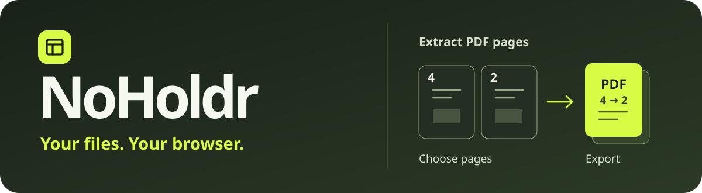
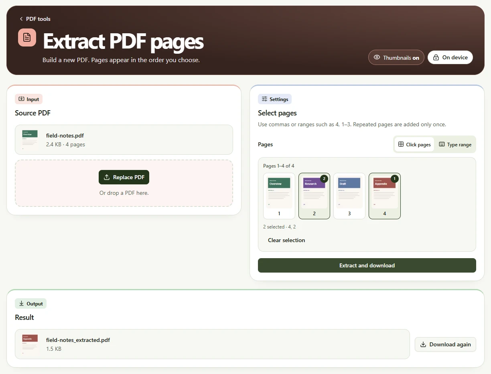

<h1 align="center">
  
</h1>

<p align="center">
  <strong>A browser toolbox for PDFs, images, audio, video, and data.</strong>
  <br />
  Process files on your device, with Google Gemini available as an opt-in tool.
</p>

<p align="center">
  <a href="https://noholdr.vercel.app/"><strong>Open NoHoldr</strong></a>
  &nbsp;·&nbsp;
  <a href="#toolbox">Toolbox</a>
  &nbsp;·&nbsp;
  <a href="#run-locally">Run locally</a>
  &nbsp;·&nbsp;
  <a href="#privacy">Privacy</a>
</p>

<p align="center">
  <a href="https://github.com/GlyphiezKay/NoHoldr/actions/workflows/ci.yml">
    
  </a>
</p>

## From source file to result



The example uses a four-page sample PDF. Pick **4** and then **2**, or type `4, 2`, and the new PDF follows that order. Clickable page tiles follow your **Thumbnails** preference and stay usable as numbered buttons when previews are off. [Try Extract PDF](https://noholdr.vercel.app/pdf/extract)

## Toolbox

| Workspace | What you can do |
| --- | --- |
| **[PDF](https://noholdr.vercel.app/pdf)** · 36 tools | Organize pages, compress to a target size, repair PDFs, run English or Indonesian OCR, fill forms, sign, redact, compare pages, and convert documents. |
| **[Image](https://noholdr.vercel.app/image)** · 17 tools | Batch compress, resize, crop, and convert images. Edit photos, remove a chosen background color, manage metadata, or build an animated GIF. |
| **[Media](https://noholdr.vercel.app/media)** · 7 tools | Trim or convert audio and video, compress video, extract an audio track, and save a frame. |
| **[Convert](https://noholdr.vercel.app/convert)** | Start with Smart Convert’s file detection or open a dedicated image, audio, video, or document converter. |
| **[Files](https://noholdr.vercel.app/files)** · 5 tools | Create and extract ZIPs, preview batch renames, compare files for duplicates, and calculate SHA-256 checksums. |
| **[Data](https://noholdr.vercel.app/data)** · 16 tools | Format JSON, inspect CSV, preview Markdown, test regex, generate QR codes, and convert timestamps or units. |
| **[AI](https://noholdr.vercel.app/ai)** · 4 tools | Chat, summarize text, describe images, or generate image metadata with your Gemini API key. |

<details>
<summary><strong>Conversion formats</strong></summary>

| Tool | Output |
| --- | --- |
| **Smart Convert** | Image to JPEG, PNG, WebP, or PDF. PDF to JPEG, PNG, or WebP. DOCX to PDF. Audio to WAV. Video to WebM or a JPEG/PNG frame. CSV ↔ JSON. |
| **Image Converter** | JPEG, PNG, WebP, BMP, AVIF, ICO, single-frame GIF, or raster-backed SVG. |
| **Audio Converter** | WAV and, where the browser supports encoding, Ogg or WebM with Opus. |
| **Video Converter** | VP8 or VP9 WebM, JPEG, or PNG. Video controls include bitrate, resolution, and frame rate. |
| **Document Converter** | Plain text, HTML, Markdown, CSV ↔ JSON, and JSON → XML. |

</details>

## Run locally

Install **Node.js 24 or later** and [pnpm 12.23.0](https://pnpm.io/installation), the version pinned in [package.json](package.json).

```bash
git clone https://github.com/GlyphiezKay/NoHoldr.git
cd NoHoldr
pnpm install --frozen-lockfile
pnpm dev
```

Open [localhost:3000](http://localhost:3000). The first run prepares the browser engines, including the pinned LibreOffice WASM assets. For a local production build, run `pnpm build` and then `pnpm start`.

## Browser and format notes

- **Office import.** Word, Excel, PowerPoint, and local HTML to PDF use LibreOffice WASM and require desktop Chromium with WebAssembly JSPI support.
- **Office export.** PDF to Word exports selectable text. Excel infers columns from text positions. PowerPoint uses one page image per slide.
- **PDF compression.** The target-size mode looks for the closest result it can find under the cap. Raster compression turns pages into images, which removes selectable text and interactive elements.
- **OCR and archives.** OCR supports English and Indonesian. PDF translation depends on the browser’s on-device Translator API. PDF/A-2b export flattens pages. Validate archival copies against your requirements.

## Privacy

The file tools process inputs in your browser. Local storage holds preferences such as **Thumbnails**, which you can switch off from supported workspaces. AI requests send the text or images you submit directly to Google Gemini using a key stored in your browser. [Privacy model](PRIVACY.md)

## Development

NoHoldr uses Next.js, TypeScript, and Tailwind CSS. The main processing engines are PDF.js, pdf-lib, qpdf WASM, Tesseract.js, LibreOffice WASM, Canvas, Web Audio, and MediaRecorder.

`pnpm check` runs the same tests, lint, type checks, and production build as [GitHub Actions](https://github.com/GlyphiezKay/NoHoldr/actions/workflows/ci.yml). Tool routes live in [src/app](src/app), shared components in [src/components](src/components), and processing code in [src/lib](src/lib).

## License

[MIT](LICENSE) · [Third-party notices](NOTICE) · [GlyphiezKay](https://github.com/GlyphiezKay)

NoHoldr adopted the MIT License on November 25, 2026, replacing the former NoHoldr Attribution License.
